

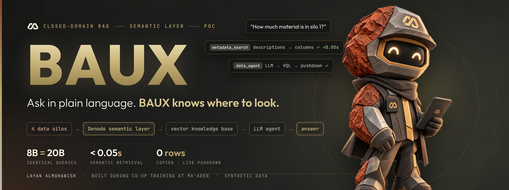

<h3>A natural-language assistant that finds the right industrial data through a governed semantic layer.</h3>

         

---

## Demo

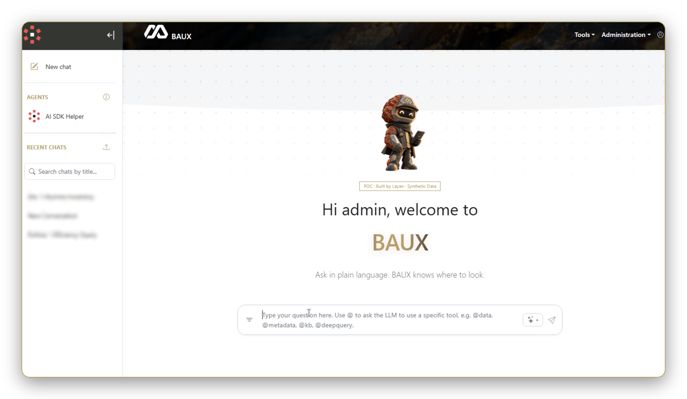

▶️ **[Watch the 2-minute demo on LinkedIn](https://www.linkedin.com/in/layan-almohawish-269461199)**

---

## Overview

### The problem

Operational data usually exists and is easy to reach. Its *meaning* is the hard part.
An engineer asks a question in business language, but the answer sits in a column or sensor tag named in a code that shares **zero words** with the question.
Only the people who memorised the naming conventions can find the number.

### The approach

BAUX doesn't train a bigger model. It puts a **semantic layer** between people and data and grounds the LLM in it.

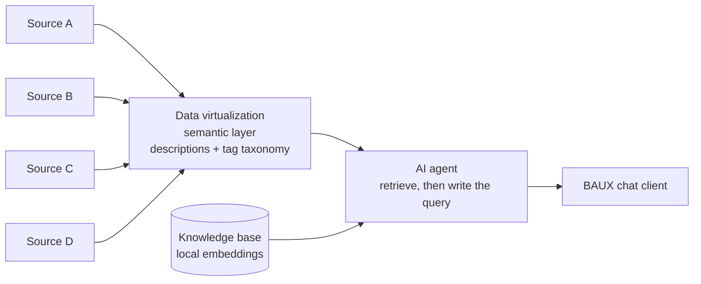

1. **Semantic modelling:** several heterogeneous sources are federated through Denodo data virtualization. Nothing is copied, and queries are pushed down to each source live.
2. **Knowledge base:** every view and column gets a business-language description and tags across several classification axes. These descriptions are embedded locally and stored in a vector store. The store holds descriptions, never data.
3. **Closed-domain RAG:** the user's question is matched against the *descriptions*, never the column names. The LLM writes the query only after retrieval has found the relevant tables and columns.
4. **Traceable answers:** every tool call (metadata search, then query) is visible in the UI, so users see *how* an answer was reached.

## Identity & design

### The story

BAUX is named after **bauxite**, the raw material where the aluminium journey begins.
Bauxite holds its value beneath the surface. Data does too: it's hidden across systems, behind names only a few people can read.
BAUX helps people reach that data by following the semantic markers their colleagues left behind.

> **BAUX doesn't know everything. BAUX knows where to look.**

### The character

An industrial guide made of bauxite rock and aluminium plate, wearing a hard hat and holding a phone: the plant's knowledge, always within reach.

| Trait | Meaning |
|---|---|
| **Grounded** | Real, practical, factory-aware |
| **Observant** | Notices what others miss |
| **Reliable** | No guessing. Only verified answers |
| **Focused** | Gets to the right place, fast |
| **Built for you** | Built by engineers, for engineers |

 

  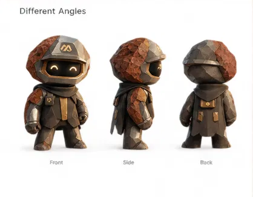
  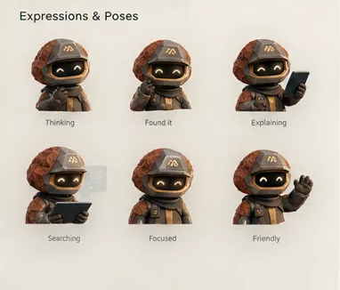

### Palette

| | Colour | Role | Meaning |
|---|---|---|---|
|  | **Bauxite Brown** `#82462D` | Primary | The raw material. Where it starts |
|  | **Aluminium Silver** `#B9B5B0` | Primary | The result. The value |
|  | **Charcoal** `#343630` | Primary | Industry. Strength |
|  | **Gold** `#B8A567` | Accent | Focus. Discovery |

The palette runs from raw ore to refined metal. That's the journey BAUX takes a question on: from cryptic data to a clear answer.

### In the interface

The chat client is a fully rebranded app with its own name, identity, port and configuration. Its tagline is *"Ask in plain language. BAUX knows where to look."*
It runs on the same semantic layer without any changes, which shows that the interface is replaceable and the semantic layer is the real asset.

## Build walkthrough

> Some details are blurred to protect the company's privacy.

### 1 · The problem: the data exists, its meaning doesn't
A plain-language question and the code the schema actually uses share **zero words**. Keyword search can't close that gap.

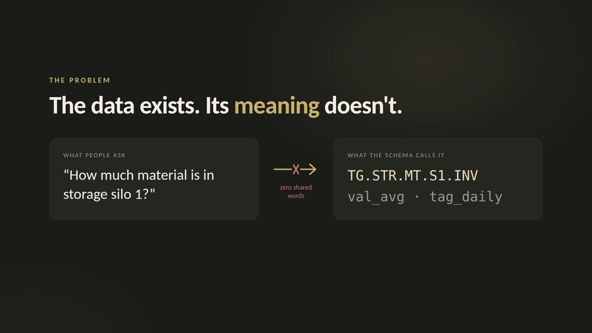

### 2 · Architecture: a semantic layer between people and data
Four independent sources, each connected over JDBC, are federated into a single virtual database in **Denodo**. There's no ETL and no data copy: Denodo holds metadata only and pushes each query down to its source. A local **knowledge base** (embeddings in Chroma) sits beside the query path, and the AI agent and the BAUX client sit on top.

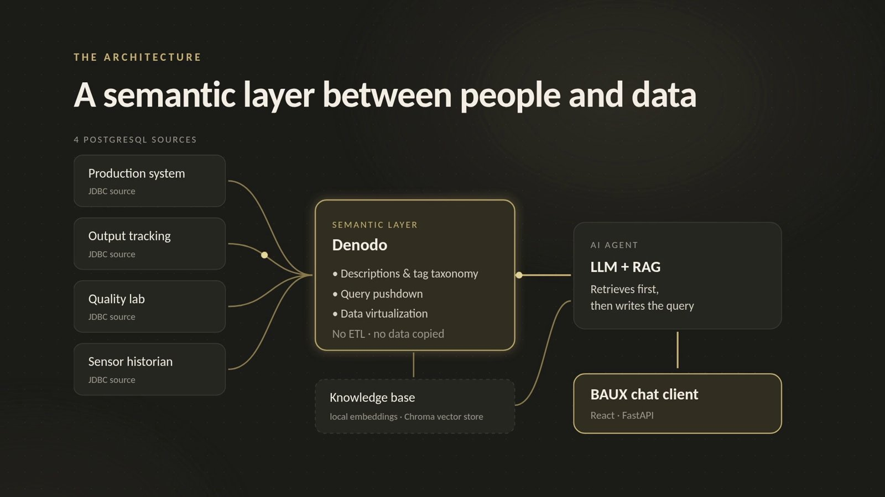

### 3 · Building the semantic layer
In Denodo Design Studio, I modelled base views over every source and wrote a **business-language description** for each view and column, plus **tags** across three classification axes. This layer is where the actual intelligence lives.

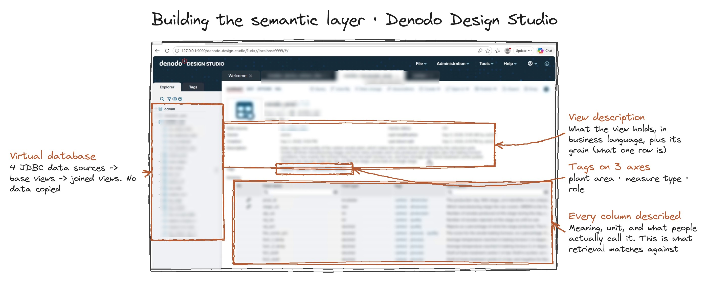

### 4 · Closed-domain RAG: grounded in its own knowledge base
The question is embedded and matched against the **descriptions**, not the column names. The LLM writes the query only after retrieval has found the right tables and columns, along with their definitions, types and grain. The query then runs live on the source, and every step is traceable.

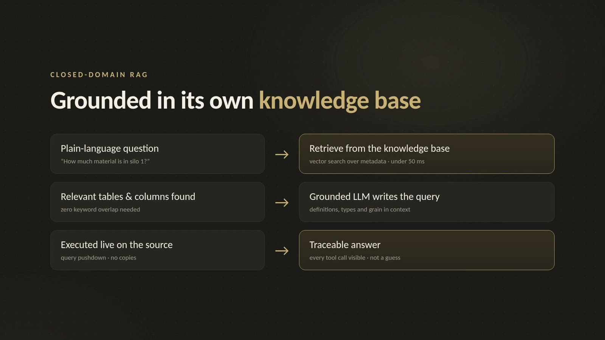

### 5 · Semantic search over the catalog
The same metadata powers search in the Data Marketplace. A concept finds the right view through its tags and descriptions, even when no keyword overlaps.

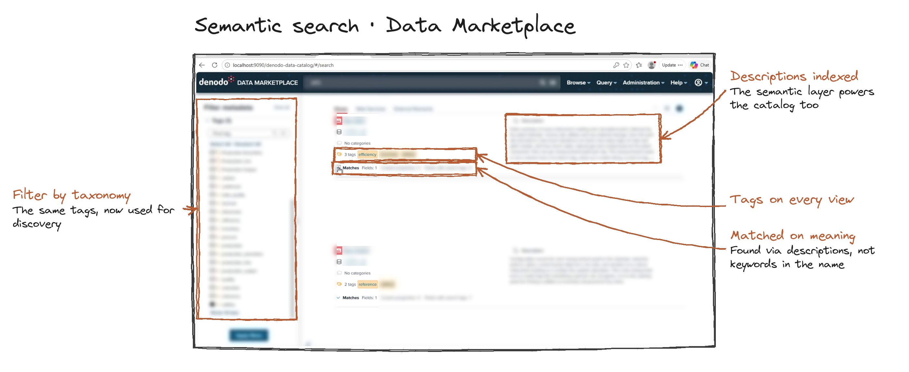

### 6 · The BAUX client
The SDK's reference chatbot is rebranded into BAUX, with its own identity, port and configuration (React + FastAPI). Users sign in with their Denodo accounts, so every answer respects their data permissions.

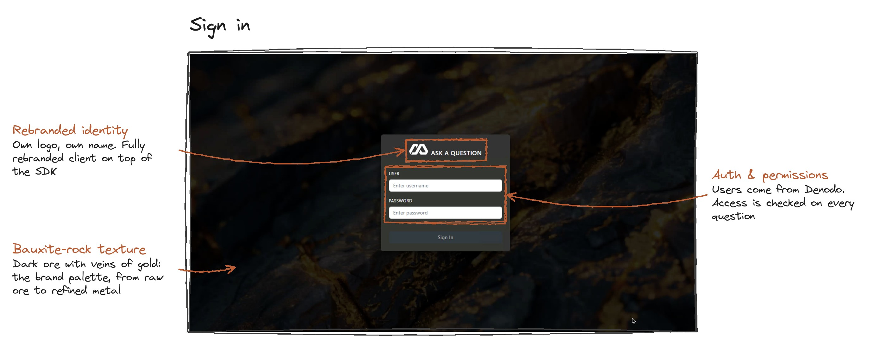

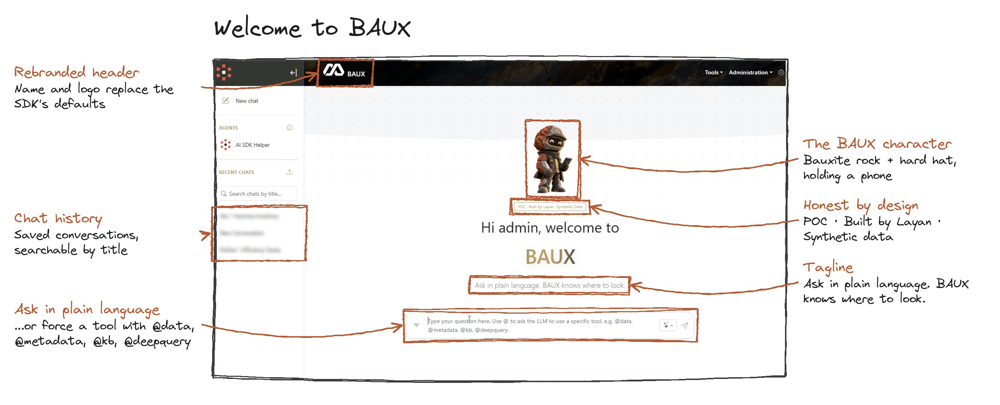

### 7 · Watching the agent think
Every step is visible as a tool call. First `metadata_search` resolves the concept, then `data_agent` writes and runs the query. Showing the mechanism makes the answer **trustworthy, not magical**.

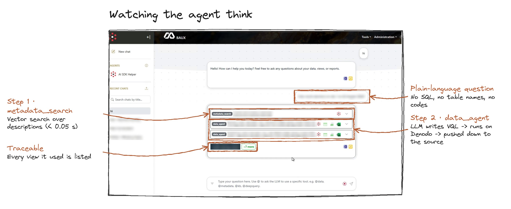

### 8 · The answer
The agent returns a structured, sourced answer with the views it used, and suggests follow-up questions. These include deeper analytical ones that run through DeepQuery.

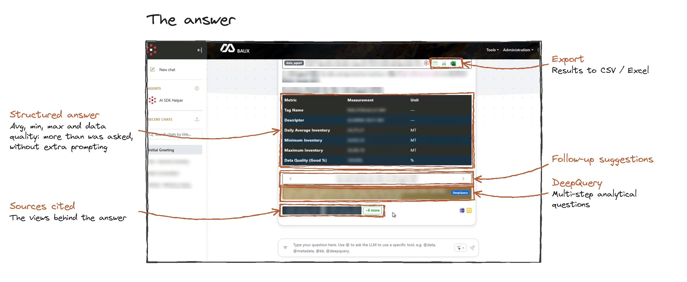

### 9 · The key finding
With the same knowledge base, a local 8B model and a hosted 20B model produced **identical queries**.

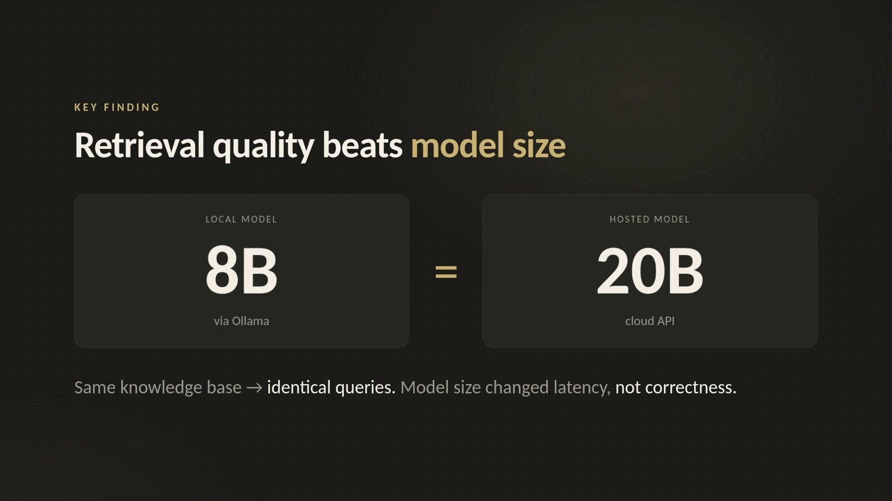

## Key findings

| Finding | What it means |
|---|---|
| **Retrieval quality beats model size.** With the same knowledge base, a local 8B model and a hosted 20B model produced *identical* queries. | Model size changed latency, not correctness. The real work is writing good descriptions. |
| **Retrieval is never the bottleneck.** Semantic search returned in under 0.05 s on every run. | All of the cost and latency comes from generation. |
| **The agent layer costs ~4.6× the tokens of a direct API call.** | A free tier that fits the API can't carry a chat UI on top of it. Size this before building. |
| **CPU-only local inference** gives correct results but isn't interactive. | RAM, not model quality, is the limit on modest hardware. |
| **The presentation layer is replaceable.** The same semantic layer served two different clients without changes. | The semantic layer is the durable asset. The interface isn't. |

Three rules for descriptions that make retrieval work, each learned the hard way:
- **Complete identifiers:** codes must appear in full. Partial codes don't survive retrieval.
- **Declared types:** say when a column is already a date, or the generated query will wrap it in a conversion that fails.
- **Stated grain:** say what one row represents, so the model filters instead of averaging.

## Tech stack

`Denodo Platform (Virtual DataPort, Data Catalog)` · `Denodo AI SDK` · `Python` · `FastAPI` · `React` · `PostgreSQL` · `Ollama` · `Chroma` · `Azure VM`

## What this project covered

- **Semantic modelling:** dimensional modelling, data virtualization, tag taxonomy
- **Closed-domain RAG:** local embeddings, vector search, grounded text-to-query
- **LLM evaluation:** local vs hosted inference, context limits, token economics of agentic tool calls
- **Full-stack delivery:** branded React + FastAPI client, deployed on Azure

## Scope and attribution

- This is a **proof of concept**, not a production system. It was evaluated only on synthetic data.
- Built during my co-op training at Ma'aden. Shared with the team's approval. It is not an official Ma'aden product.
- The BAUX client is a rebranded fork of the sample chatbot in the open-source [Denodo AI SDK](https://github.com/denodo/denodo-ai-sdk) (Apache License 2.0). The SDK itself was not modified. *Denodo* is a trademark of Denodo Technologies, and this project is not affiliated with or endorsed by it.
- The Ma'aden logo shown in the interface and on the character belongs to Ma'aden and is used here with the team's approval.
- Source code, data models and configuration are **intentionally not published**. This repository is a portfolio showcase.

---

**Layan Almohawish** · AI & Machine Learning
[LinkedIn](https://www.linkedin.com/in/layan-almohawish-269461199)

© 2026 Layan Almohawish. All rights reserved.
